# InfraOrgIT

InfraOrgIT is one place to describe an organization's IT infrastructure and to
work on it from the browser. You model the chain once — provider → environment
→ server → deployed application → project — and the same model drives the
topology diagram, API tests, network checks, the SSH console, the file browser,
AI actions and the audit log, with permissions per environment.

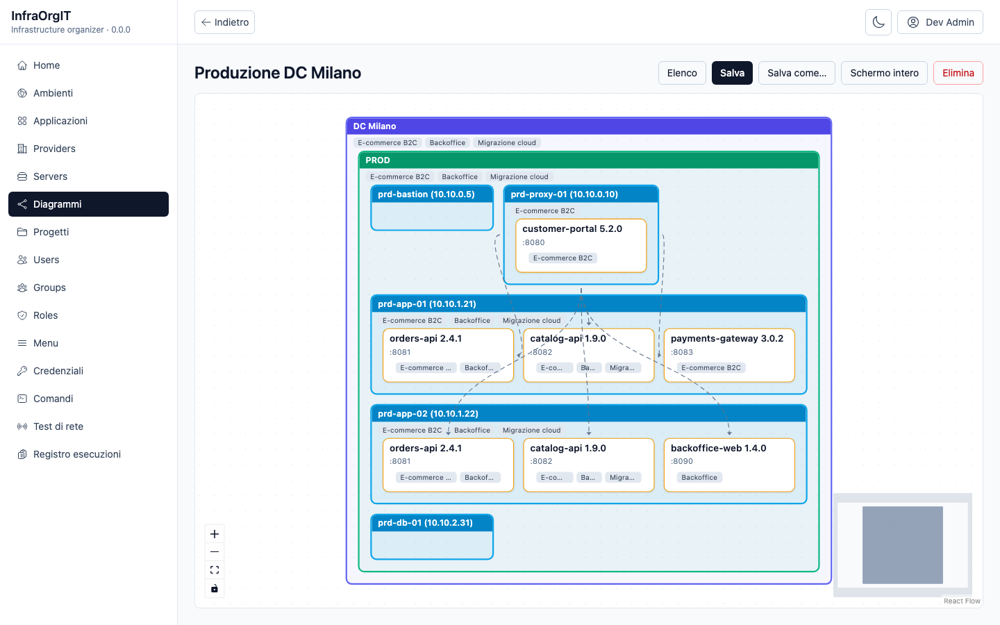

## What it does

### Model the infrastructure

- **Providers and environments**: datacenters and clouds, each with its
  environments (PRE, INT, PROD…).
- **Servers**: IP and public address, hostname, SSH port and jump host, sizing,
  operating system, HA node and third-party operator.
- **Applications**: backend, frontend or infrastructure (SFTP, RabbitMQ,
  NGINX, Elastic, Kibana, Kafka, MySQL, MongoDB, Redis), each with versions.
- **Deployments**: an application version on a server and port, with runtime,
  image, container name, compose folder, host port and HA role.
- **Projects and traffic**: group applications, list their servers and draw
  proxy connections and routes. The interactive diagram is filtered by
  provider, environment or project and keeps saved layouts.

### Test, operate and audit

- **API tests** from an imported OpenAPI 3.x or Swagger 2.0 document, with the
  environment hostname and encrypted API keys.
- **Reachability tests** run from the server itself over SSH: the result is
  what that server really reaches, OK or KO.
- **SSH console and files**: several sessions side by side or minimized, plus
  an SFTP/FTPS browser and command templates.
- **Application actions** such as restart, logs and health check, with optional
  confirmation, idempotency and shell-metacharacter checks.
- **Audit log** of consoles, actions, tests, MCP calls and tunnels. The audit
  chain is tamper-evident and can be anchored to an external SIEM/WORM sink.

### Roles, language and theme

Keycloak login through a backend-for-frontend keeps tokens out of the browser.
`SystemAdmin` owns the master data; `ServerAdmin` and `ServerOperator` are
granted per environment and decide what a user can open or run. The menu is
configurable, the interface is Italian and English, and the
light/dark/system theme is remembered per user.

### AI with a human in the loop

MCP clients can read the inventory and request actions. Read tools use
`mcp:read`/`mcp:operate`; action tools also need an `McpGrant`, the environment
operator right and a human approval. The AI receives an `approvalId`, the
request waits on `/approvals`, and only the owner can approve it from a browser
session. The approval is one-time, expires after 10 minutes and is bound to the
exact target and parameters.

### Desktop tunnels

InfraOrgIT Desktop opens instances in one window with isolated tabs and
manages SSH tunnels through the user's SSH agent: `-L`, `-D`, `-R`, jump
chains and custom services. The tunnel drawer groups servers by environment,
searches by machine/IP/service and reuses the instance BFF session, so a user
already signed in to the Web app does not need a second login. The desktop
shell follows the account theme. The instance shows the live sessions on
`/tunnels`; the legacy Photino build additionally supports `autoStart` and
automatic reconnect.

## See it in action

The screenshots and recordings come from a local instance with fictitious
data.

**Diagram**

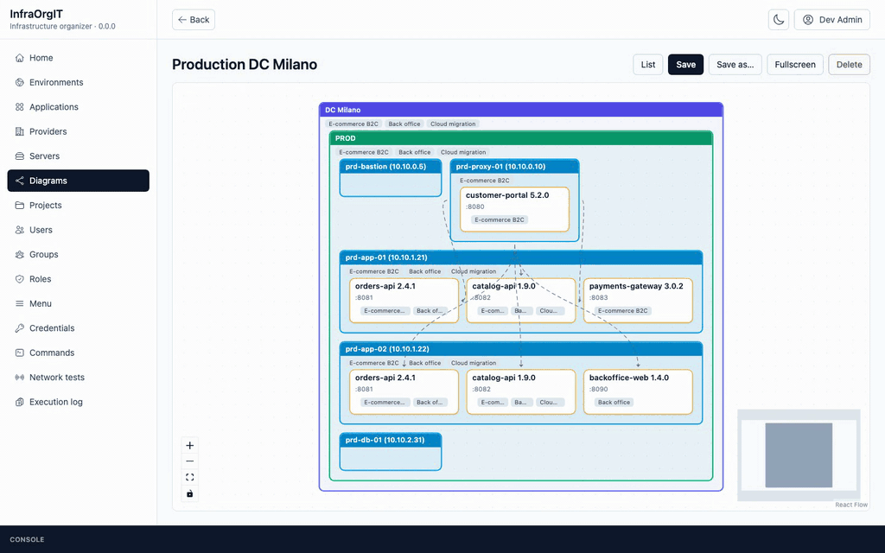

| Servers | Application |
|---|---|
| 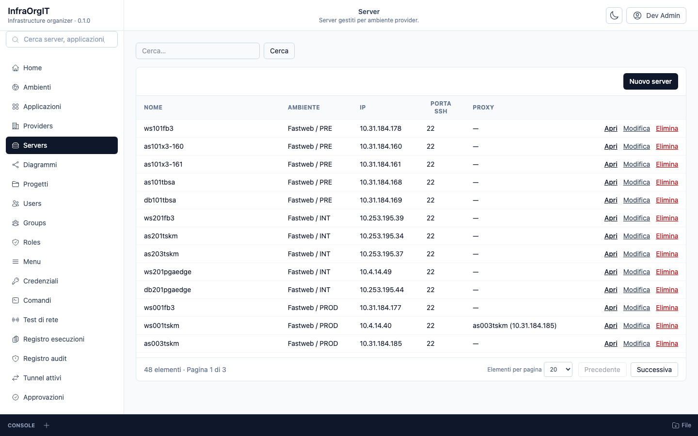 | 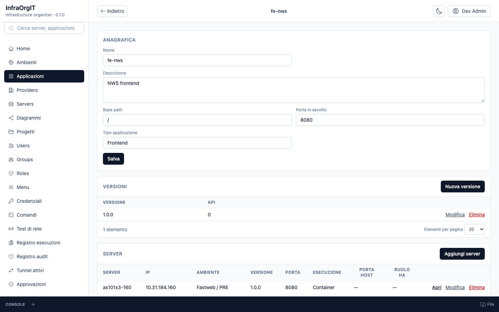 |
| **Server detail** | **Execution log** |
| 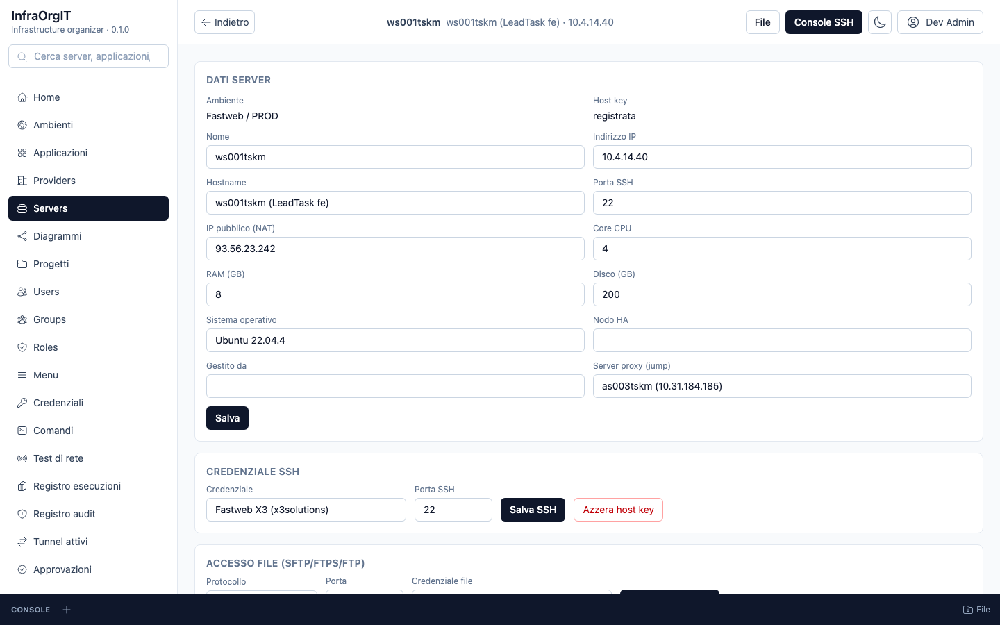 | 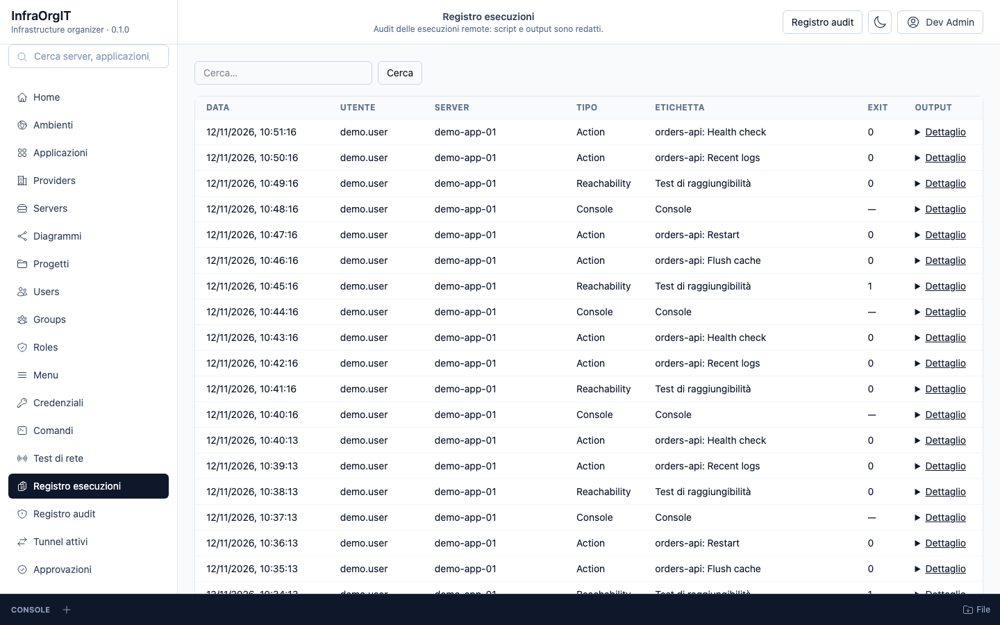 |

**Network tests and application actions**

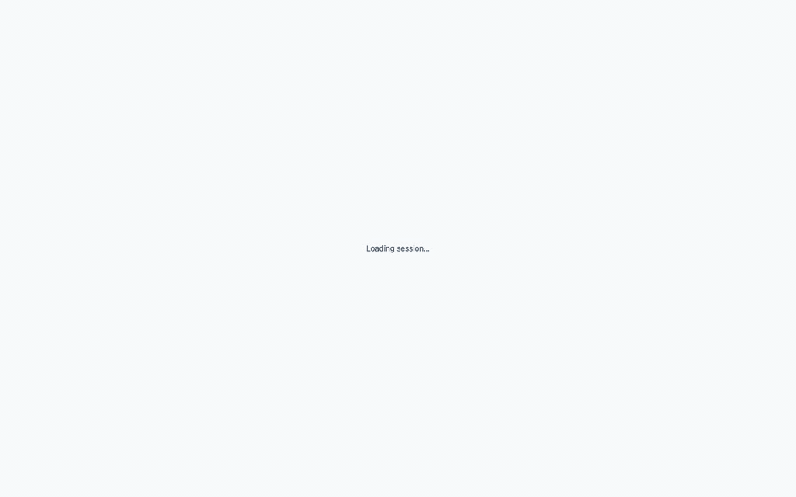

**SSH console**

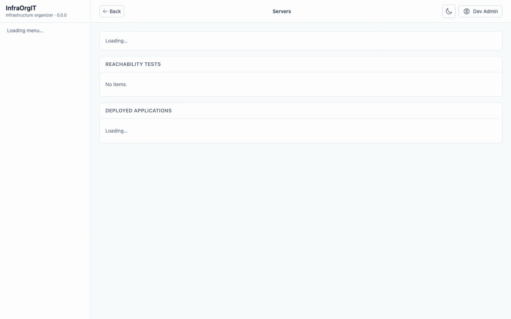

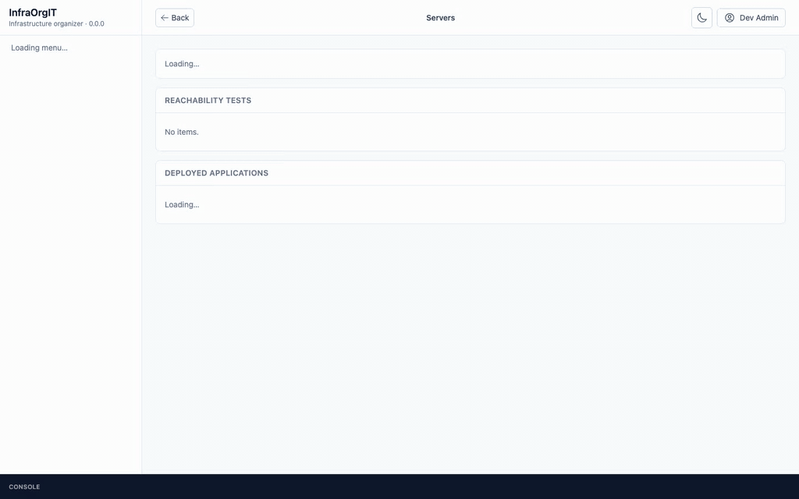

**Human approval for AI actions**

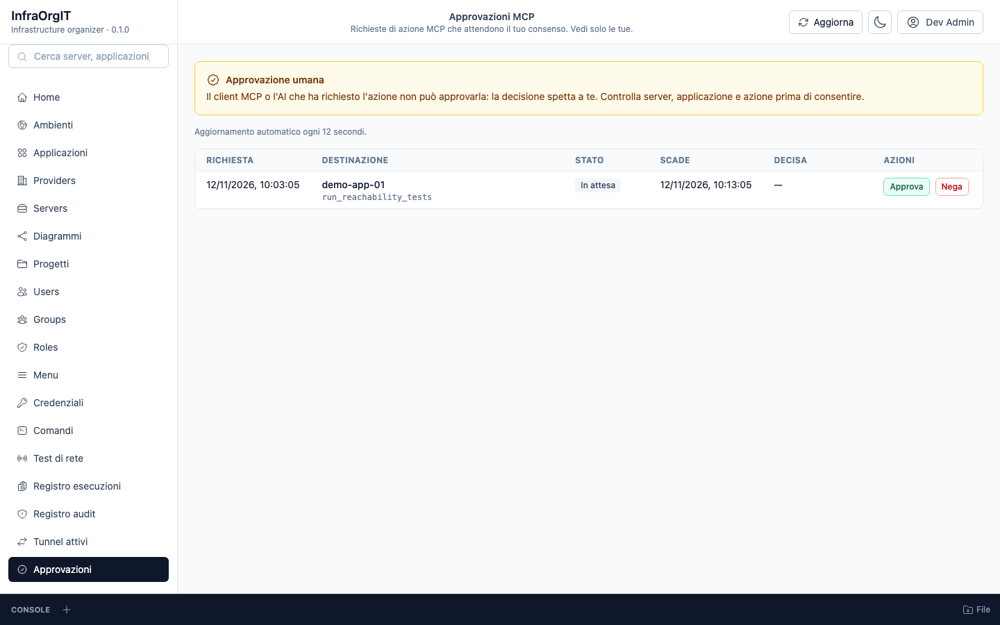

**Desktop tunnels**

| Landing | Tunnel drawer |
|---|---|
| 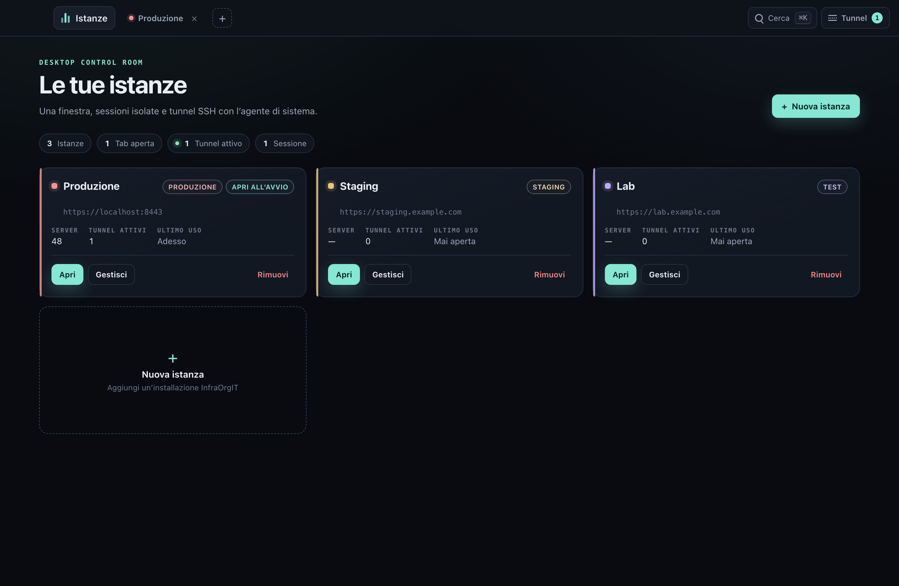 | 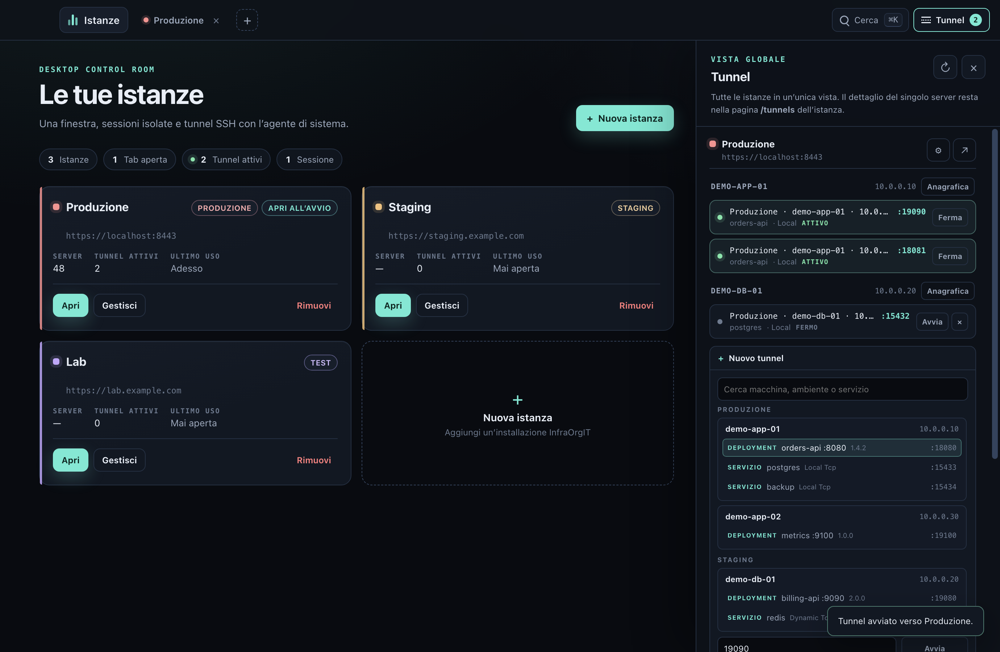 |

**Tunnels and audit**

| Active tunnels | Audit log |
|---|---|
| 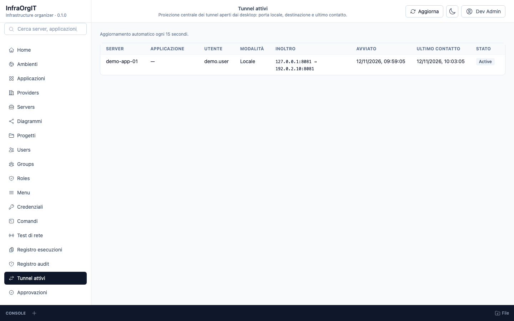 | 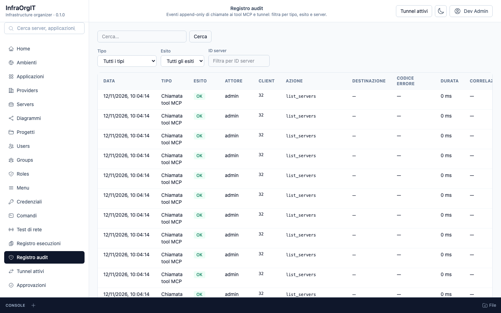 |

## Start

### On a server, from published images

Requirements: Docker Engine with Compose v2, and this repository. No API or web
source and no local build.

```bash
git clone https://github.com/SenseiKiritof/AllInfraOrgIT.git
cd AllInfraOrgIT
cp deploy/.env.example deploy/.env   # replace CHANGE_ME_* secrets and pin tags/digests
deploy/scripts/check-env.sh deploy/.env
make up-images
```

Open `https://localhost:8443`; the Keycloak console is on
`http://localhost:18081/admin`. The stack includes MySQL, Keycloak, the API,
the web app and Caddy. MFA is opt-in with `KEYCLOAK_MFA=true`; plain FTP is
disabled by default. The full guide, TLS, backup and update notes are in
[`deploy/README.md`](deploy/README.md).

### Locally, from source

Requirements: Docker Compose v2, .NET SDK 10, Node 24, Yarn 1.22 and `make`.

```bash
git clone https://github.com/SenseiKiritof/AllInfraOrgIT.git
git clone https://github.com/SenseiKiritof/InfraOrgITApi.git
git clone https://github.com/SenseiKiritof/InfraOrgITWeb.git
git clone https://github.com/SenseiKiritof/InfraOrgITDocker.git
git clone https://github.com/SenseiKiritof/InfraOrgITDesktop.git   # optional
cd AllInfraOrgIT
make dev
```

`make dev` applies the migrations, starts MySQL and Keycloak, the API on
`:5298` and Vite on `:3000`. Use `make full` for the single Compose stack on
`https://localhost:8443`. Development credentials are in
`InfraOrgITDocker/.env`.

## Workspace

| Repository | Content |
|---|---|
| [`AllInfraOrgIT`](https://github.com/SenseiKiritof/AllInfraOrgIT) | this repository: docs, ADRs, orchestration, deploy, release lock |
| [`InfraOrgITApi`](https://github.com/SenseiKiritof/InfraOrgITApi) | .NET 10 API, EF migrations, MCP, legacy importer |
| [`InfraOrgITWeb`](https://github.com/SenseiKiritof/InfraOrgITWeb) | React 19 + Vite browser app |
| [`InfraOrgITDocker`](https://github.com/SenseiKiritof/InfraOrgITDocker) | local Compose stack, Caddy, Keycloak |
| [`InfraOrgITDesktop`](https://github.com/SenseiKiritof/InfraOrgITDesktop) | Electron shell, plus the legacy .NET 10 + Photino build |

## Learn more

- [`docs/development.md`](docs/development.md) — workspace, commands, tests,
  branching, release and generated contracts.
- [`docs/operations/release.md`](docs/operations/release.md) — release,
  version tags, images and rollback.
- [`docs/security/permissions.md`](docs/security/permissions.md) — role
  matrix and environment rules.
- [`docs/security/pentest-2026-11.md`](docs/security/pentest-2026-11.md) —
  internal pentest, OWASP mappings and remediation status.
- [`docs/architecture/mcp-server-and-tunnels.md`](docs/architecture/mcp-server-and-tunnels.md)
  — MCP and tunnel architecture.
- [`docs/README.md`](docs/README.md) — document index.
- [`docs/backlog.md`](docs/backlog.md) — open work and verification.

## Status

Backend, browser app, RBAC, remote management, MCP, desktop tunnels and the
legacy importer are working. The full stack runs from published multi-arch
images; the API and web images are signed with cosign and include SBOM and
provenance on non-PR builds. The remaining release work is the rehearsal on a
representative legacy dataset and the first real signed desktop release.
