# InfraOrgIT

InfraOrgIT is one place to describe an organization's IT infrastructure and to
work on it from the browser. You model the chain once — provider → environment
→ server → deployed application → project — and the same model drives the
topology diagram, API tests, network checks, the SSH console, the file browser,
AI actions and the audit log, with permissions per environment.

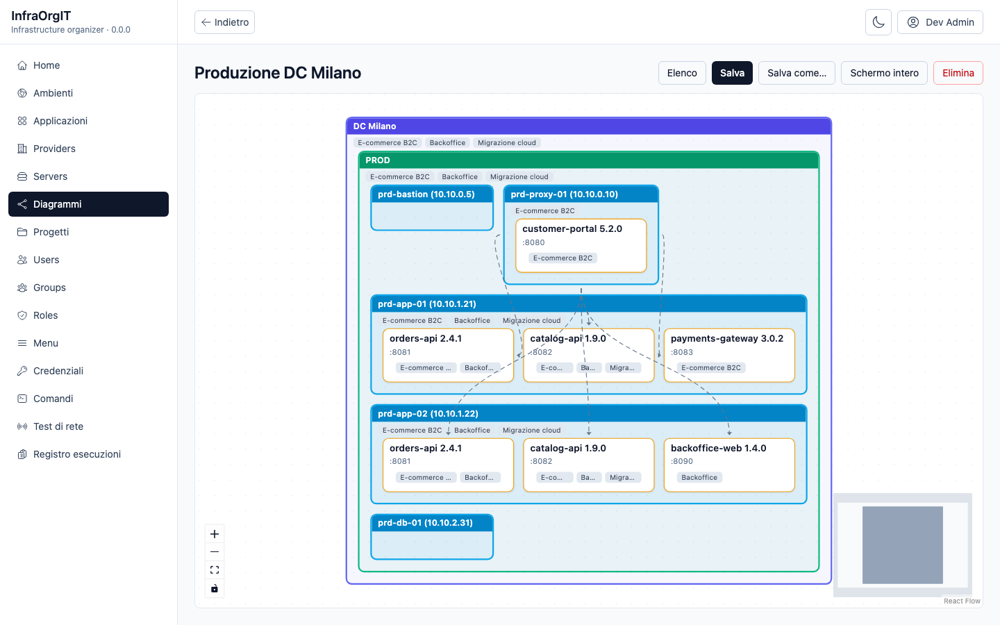

## What it does

### Model the infrastructure

- **Providers and environments**: datacenters and clouds, each with its
  environments (PRE, INT, PROD…).
- **Servers**: IP and public address, hostname, SSH port and jump host, sizing,
  operating system, HA node and third-party operator.
- **Applications**: backend, frontend or infrastructure (SFTP, RabbitMQ,
  NGINX, Elastic, Kibana, Kafka, MySQL, MongoDB, Redis), each with versions.
- **Deployments**: an application version on a server and port, with runtime,
  image, container name, compose folder, host port and HA role.
- **Projects and traffic**: group applications, list their servers and draw
  proxy connections and routes. The interactive diagram is filtered by
  provider, environment or project and keeps saved layouts.

### Test, operate and audit

- **API tests** from an imported OpenAPI 3.x or Swagger 2.0 document, with the
  environment hostname and encrypted API keys.
- **Reachability tests** run from the server itself over SSH: the result is
  what that server really reaches, OK or KO.
- **SSH console and files**: several sessions side by side or minimized, plus
  an SFTP/FTPS browser and command templates.
- **Application actions** such as restart, logs and health check, with optional
  confirmation, idempotency and shell-metacharacter checks.
- **Credentials**: shared or per-user SSH credentials, optional offline use and
  desktop devices that download them encrypted for their own RSA key.
- **Audit log** of consoles, actions, tests, MCP calls and tunnels. The audit
  chain is tamper-evident and can be anchored to an external SIEM/WORM sink.

### Roles, language and theme

Keycloak login through a backend-for-frontend keeps tokens out of the browser.
`SystemAdmin` owns the master data; `ServerAdmin` and `ServerOperator` are
granted per environment and decide what a user can open or run. The menu is
configurable, the interface is English by default with Italian, French,
German and Spanish translations (missing strings fall back to English), and
the light/dark/system theme is remembered per user. Global search and the
console launcher support ArrowUp/ArrowDown, Enter and Escape; the active row
stays visible in both themes.

### AI with a human in the loop

MCP clients can read the inventory and run approved actions. Read tools use
`mcp:read`/`mcp:operate`; the first action call creates a Pending agent. The
owner approves the agent once from `/approvals` with individual permissions
(`reachability.run`, `actions.run`, per environment or all), then edits or
revokes them at any time. The MCP client can request a new permission and the
owner decides. Action calls still need the environment operator right and
`confirm=true`; RBAC, rate limits and audit stay mandatory.

### Desktop tunnels and offline work

InfraOrgIT Desktop opens instances in one window with isolated tabs and
manages SSH tunnels through the user's SSH agent or a downloaded credential:
`-L`, `-D`, `-R`, jump chains and custom services. `Local` tunnels and
console/files/actions run with the downloaded credential in memory; `Dynamic`
and `Remote` still need an agent key. The tunnel drawer groups servers by
environment, searches by machine/IP/service and reuses the instance BFF
session, so a user already signed in to the Web app does not need a second
login. The desktop shell follows the account theme. The instance shows the live
sessions on `/tunnels`.

When the instance is unreachable the desktop keeps an encrypted inventory
snapshot, opens Client tunnels and runs local TCP/TLS/HTTP checks from the
machine or through the first jump host. Check results and tunnel events are
queued in an encrypted outbox and synchronized to the central audit when the
instance returns. Offline credential copies exist only when `AllowOffline` is
enabled and are dropped on logout, device revocation or a credential version
change.

### Standalone desktop with a local instance

InfraOrgIT Desktop can run without Keycloak, Docker, MySQL or a remote server:
**Impostazioni → Istanza locale** starts the bundled .NET API on loopback, keeps
the inventory in SQLite under the desktop data directory and serves the normal
Web workspace. The local user is a SystemAdmin with no login prompt; the OS
account is the trust boundary. Remote instances stay available in the same
window. Local SSH tunnels, console, files and actions use the same code as the
remote mode.

The local API exposes versioned inventory export/import
(`.infraorgit.json`): checksummed JSON, dry-run summary, `replace` into an empty
local database, automatic pre-import backup and credential metadata without
secrets. **Impostazioni → Dati e backup** gives the same export, preview,
confirm/replace and warning flow in the browser. The package includes the API
and Web resources; the Settings toggle takes effect on the next launch.

### Credentials and device enrollment

`/credentials` marks a credential as shared (installation-wide) or owned by a
user, enables offline use and lists the enrolled desktop devices. Each desktop
registers an RSA-3072 public key; the API encrypts the downloaded secret with
AES-256-GCM and RSA-OAEP for that device only, and the private key stays in
Electron `safeStorage`. Shared credentials are downloadable by operators of an
environment where they are assigned, while personal credentials are
download-only and cannot be assigned to servers or file transfer. Downloads are
audited as `CredentialDownload`; revoking a device clears its cached copies on
the next enrollment.

### Choose where connections run

Every installation has one connection policy, set by `SystemAdmin` in
**Impostazioni** (`/settings`). The default is **Auto**:

| Mode | What runs where | Best for |
|---|---|---|
| **Auto** (default) | Tunnels, console, files and actions use the desktop when the client reaches the first SSH hop **and** has a key-based agent or a downloaded credential; otherwise they use the server. A password credential without a downloaded copy uses the server. | Most installations; keeps the fast path local and still works behind NAT/firewalls. |
| **Server** | The API node opens SSH with the stored server credential. Tunnels are relayed to the desktop; console, files and actions run on the server. Only `Local` services and deployments with a fixed target port are relayed. | Clients cannot reach SSH hosts, or traffic must leave through the server. |
| **Client** | Tunnels, console, files and actions run in the desktop with the SSH agent or a downloaded credential; no server SSH. `Local`, `Dynamic` and `Remote` tunnels stay available, but `Dynamic` and `Remote` require an agent key. | Operators have an SSH agent or downloaded credentials and direct network access. |

The policy lives in the shared MySQL database (`ConnectionPolicies`), so every
API node in a cluster applies the same mode without a restart. Relay
connections are owned by the node that accepts the WebSocket; each local TCP
connection opens its own relay, so the load balancer needs WebSocket upgrades
but no sticky sessions. Direct file downloads stream to a native save dialog;
direct uploads are capped at 8 MB and larger files need `Auto` or `Server`.
See [ADR-013](docs/adr/013-connection-policy.md).

## See it in action

The screenshots and recordings come from a local instance with fictitious
data.

**Diagram**

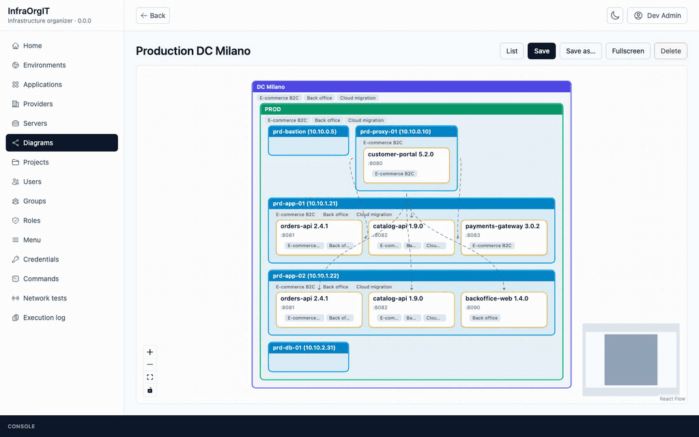

| Servers | Application |
|---|---|
| 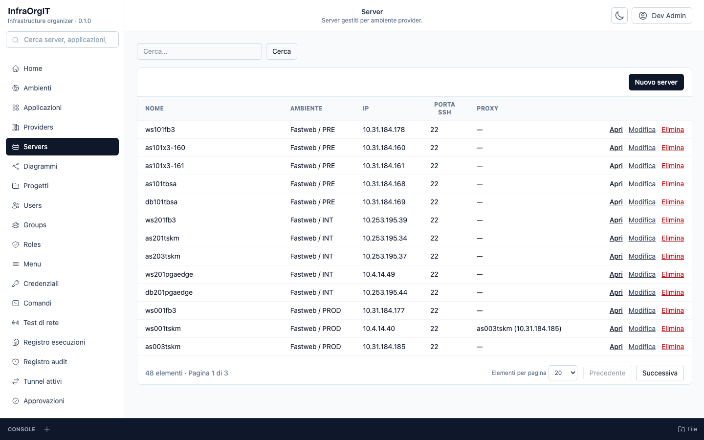 | 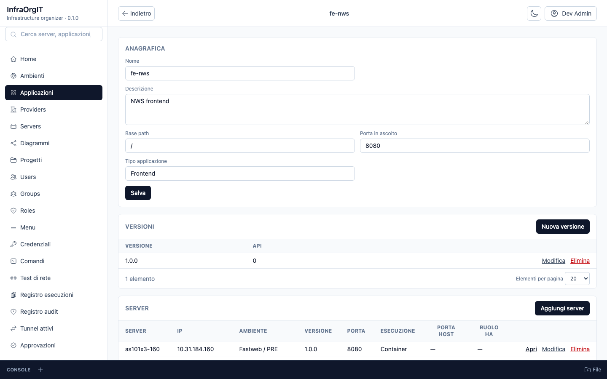 |
| **Server detail** | **Execution log** |
| 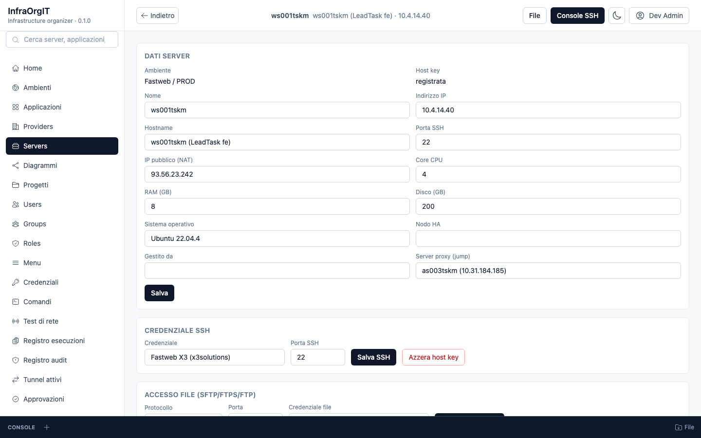 | 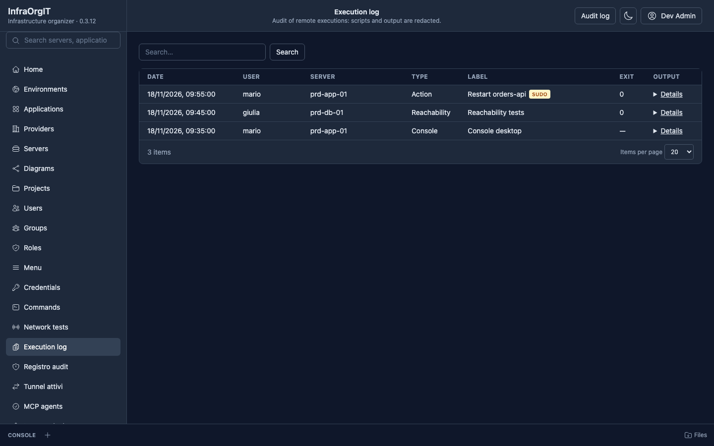 |

**Network tests and application actions**

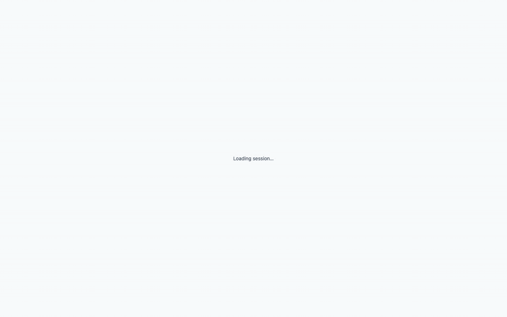

**SSH console**

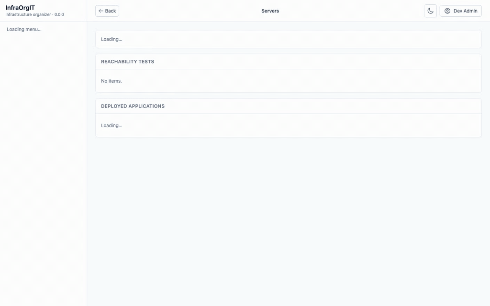

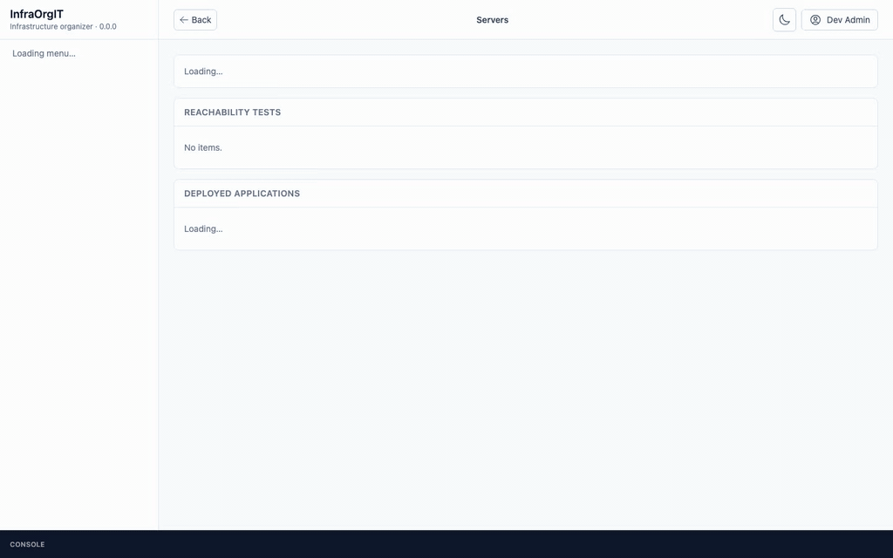

**Agent approval for AI actions**

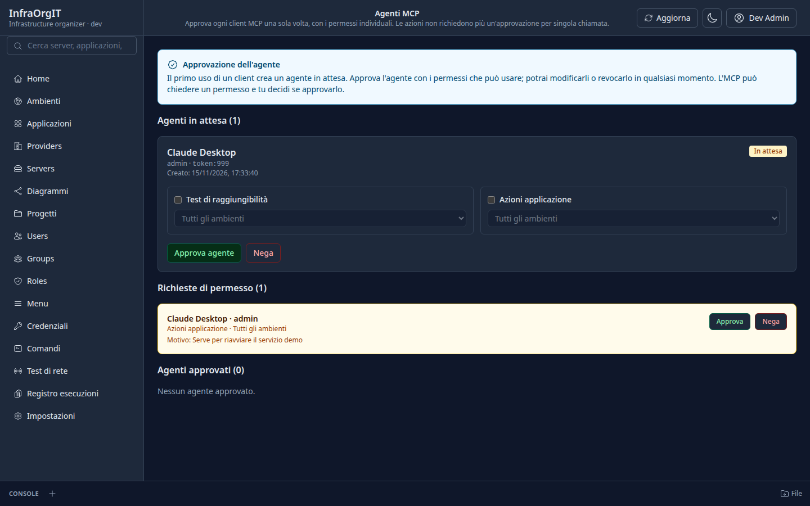

**Credentials and offline checks**

| Credentials and devices | Local check |
|---|---|
| 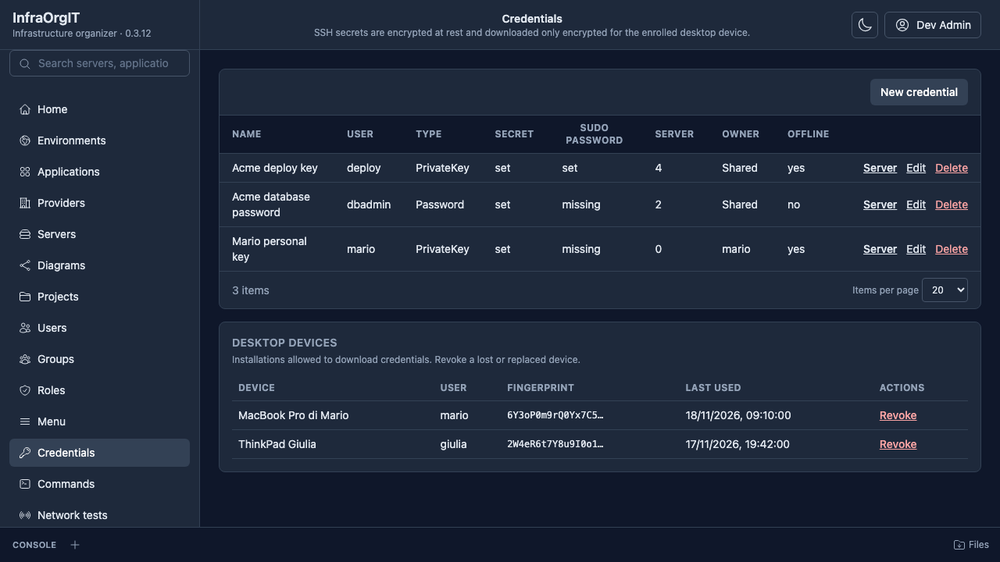 | 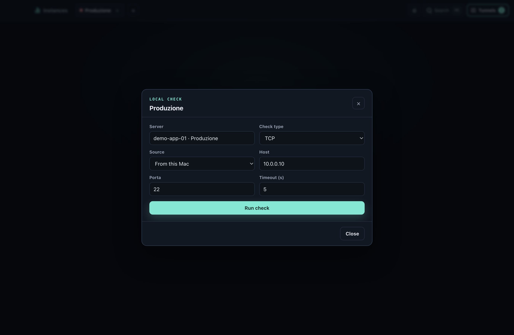 |

**Desktop tunnels**

| Landing | Tunnel drawer |
|---|---|
| 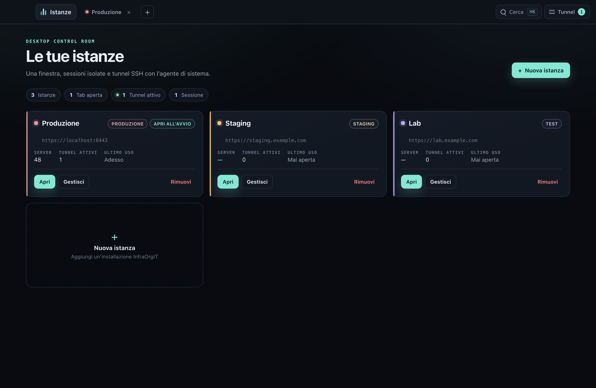 | 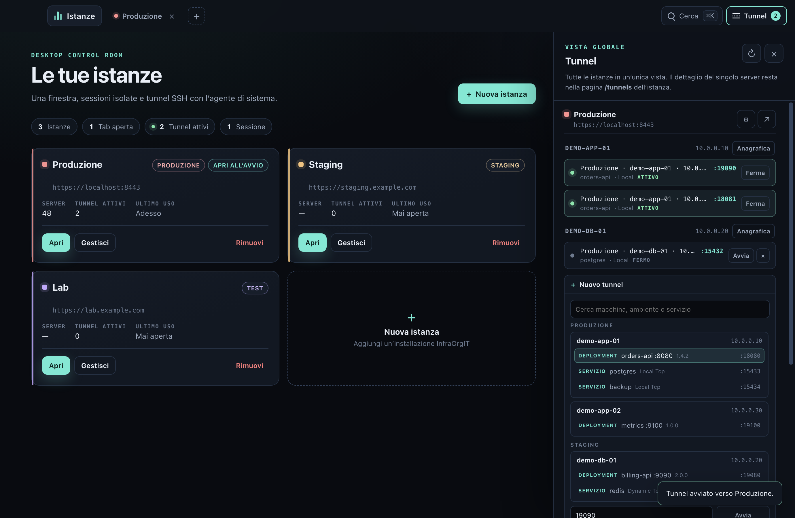 |

**Tunnels and audit**

| Active tunnels | Audit log |
|---|---|
| 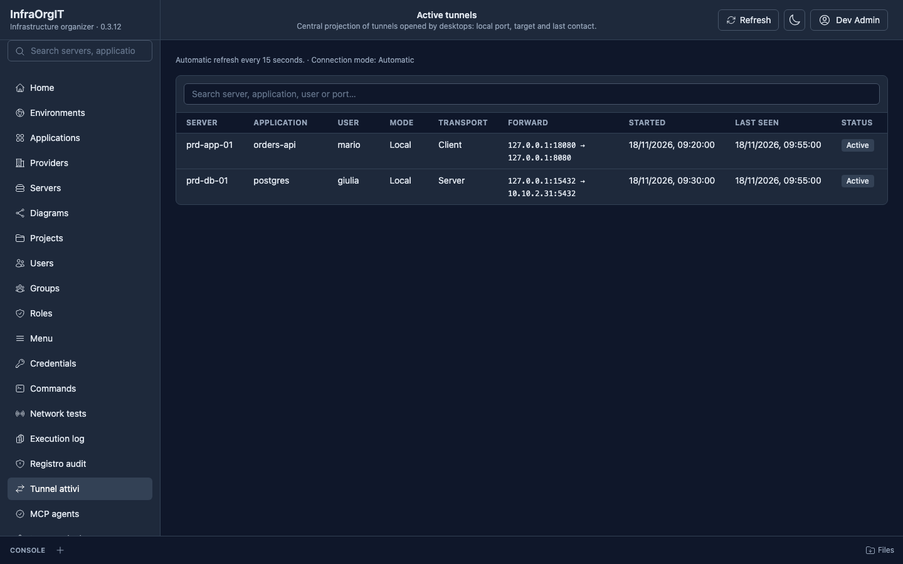 | 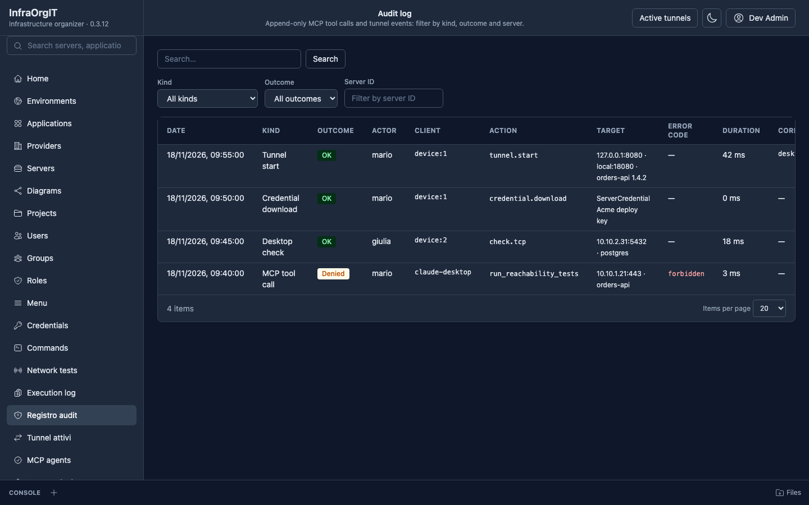 |

## Start

### On a server, from published images

Requirements: Docker Engine with Compose v2, and this repository. No API or web
source and no local build.

```bash
git clone https://github.com/SenseiKiritof/AllInfraOrgIT.git
cd AllInfraOrgIT
cp deploy/.env.example deploy/.env   # replace CHANGE_ME_* secrets and pin tags/digests
deploy/scripts/check-env.sh deploy/.env
make up-images
```

Open `https://localhost:8443`; the Keycloak console is on
`http://localhost:18081/admin`. The stack includes MySQL, Keycloak, the API,
the web app and Caddy. MFA is opt-in with `KEYCLOAK_MFA=true`; plain FTP is
disabled by default. The full guide, TLS, backup and update notes are in
[`deploy/README.md`](deploy/README.md).

### Locally, from source

Requirements: Docker Compose v2, .NET SDK 10, Node 24, Yarn 1.22 and `make`.

```bash
git clone https://github.com/SenseiKiritof/AllInfraOrgIT.git
git clone https://github.com/SenseiKiritof/InfraOrgITApi.git
git clone https://github.com/SenseiKiritof/InfraOrgITWeb.git
git clone https://github.com/SenseiKiritof/InfraOrgITDocker.git
git clone https://github.com/SenseiKiritof/InfraOrgITDesktop.git   # optional
cd AllInfraOrgIT
make dev
```

`make dev` applies the migrations, starts MySQL and Keycloak, the API on
`:5298` and Vite on `:3000`. Use `make full` for the single Compose stack on
`https://localhost:8443`. Development credentials are in
`InfraOrgITDocker/.env`. A source web image shows `dev` in the sidebar unless it
is built with `--build-arg APP_VERSION=...`; published images receive the
release tag.

For a machine with no server stack, install the desktop package and enable
**Impostazioni → Istanza locale**. The package carries the API and Web bundle;
data stays in the desktop user-data directory. The packages are unsigned, so
the first launch needs the usual Gatekeeper/SmartScreen confirmation.

## Workspace

| Repository | Content |
|---|---|
| [`AllInfraOrgIT`](https://github.com/SenseiKiritof/AllInfraOrgIT) | this repository: docs, ADRs, orchestration, deploy, release lock |
| [`InfraOrgITApi`](https://github.com/SenseiKiritof/InfraOrgITApi) | .NET 10 API, EF migrations, MCP, legacy importer |
| [`InfraOrgITWeb`](https://github.com/SenseiKiritof/InfraOrgITWeb) | React 19 + Vite browser app |
| [`InfraOrgITDocker`](https://github.com/SenseiKiritof/InfraOrgITDocker) | local Compose stack, Caddy, Keycloak |
| [`InfraOrgITDesktop`](https://github.com/SenseiKiritof/InfraOrgITDesktop) | Electron desktop shell |

## Learn more

- [`docs/development.md`](docs/development.md) — workspace, commands, tests,
  branching, release and generated contracts.
- [`docs/operations/release.md`](docs/operations/release.md) — release,
  version tags, images and rollback.
- [`docs/security/permissions.md`](docs/security/permissions.md) — role
  matrix and environment rules.
- [`docs/security/pentest-2026-11.md`](docs/security/pentest-2026-11.md) —
  internal pentest, OWASP mappings and remediation status.
- [`docs/architecture/mcp-server-and-tunnels.md`](docs/architecture/mcp-server-and-tunnels.md)
  — MCP and tunnel architecture.
- [`docs/README.md`](docs/README.md) — document index.
- [`docs/backlog.md`](docs/backlog.md) — open work and verification.

## Status

Backend, browser app, RBAC, remote management, MCP, desktop tunnels, offline
work and the legacy importer are working. The current 0.3.x line is the full-stack
and desktop release; the published multi-arch API and web images are signed
with cosign and include SBOM and provenance on non-PR builds. The remaining
release work is Electron/Windows signing and notarization, credential rotation
notification with a local cleanup action, clean-machine package checks and the
rehearsal on a representative legacy dataset.
