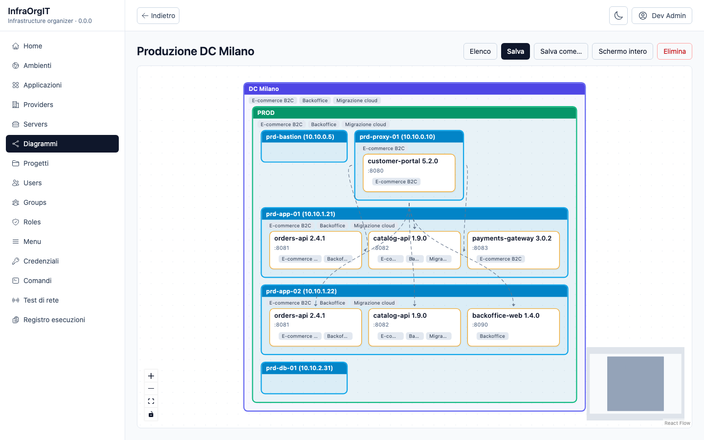
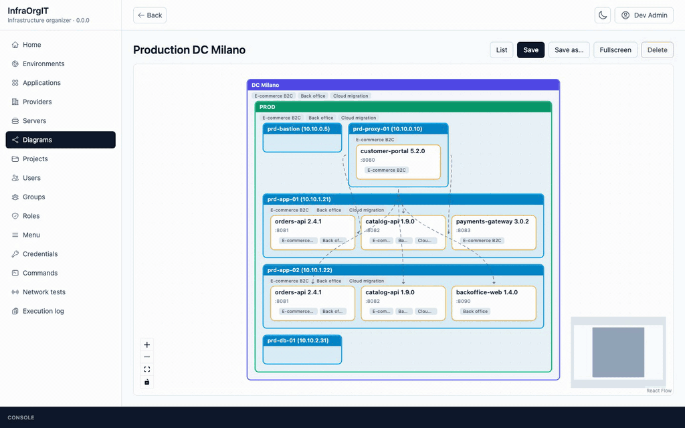
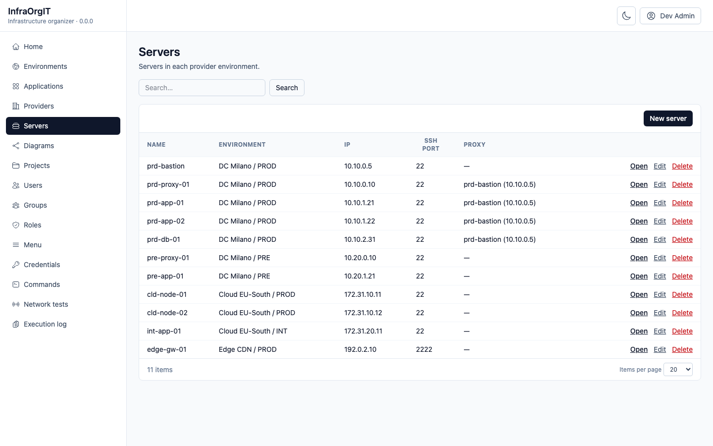
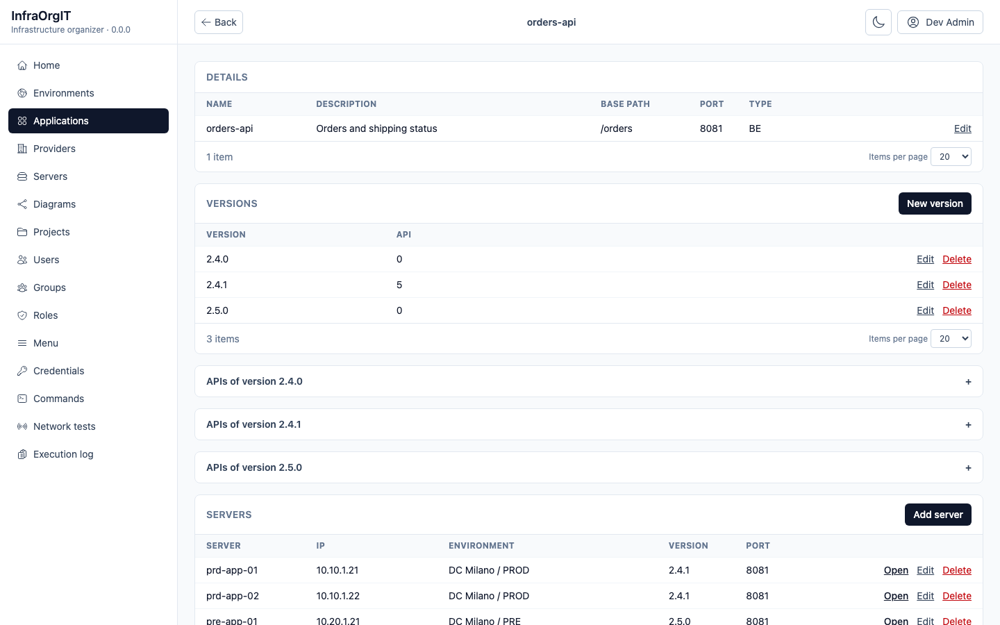
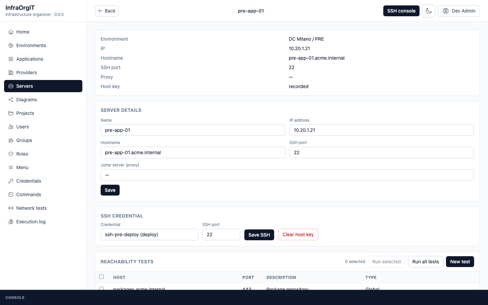
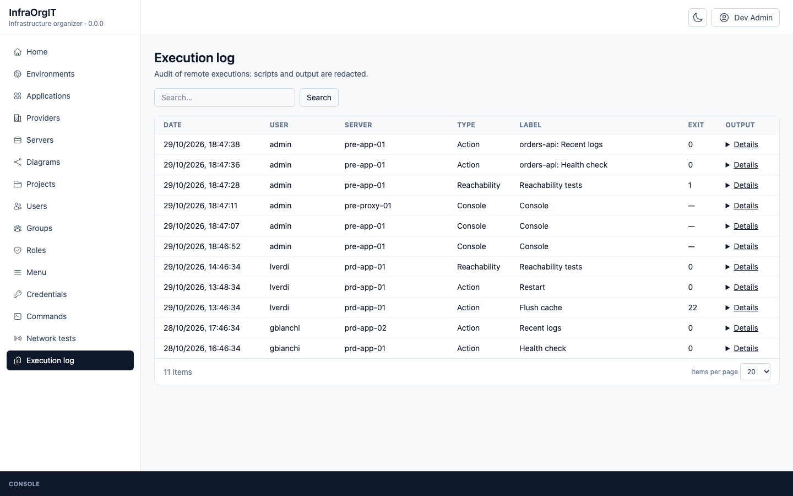
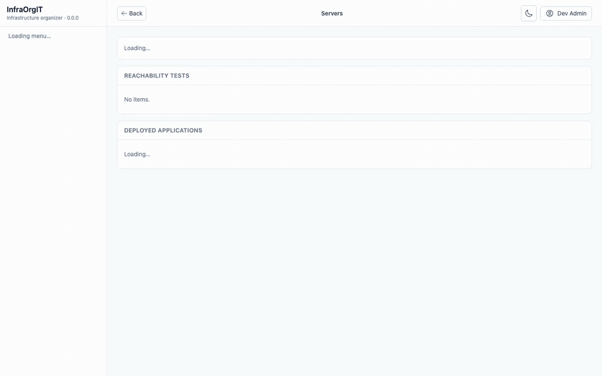
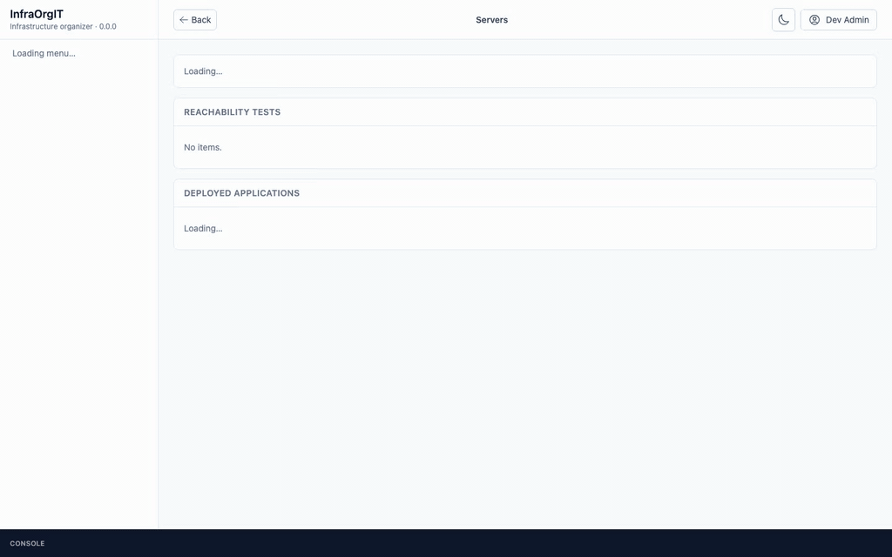

# InfraOrgIT

InfraOrgIT is one place to describe an organization's IT infrastructure and to work on it from the browser. You model the chain once, from provider to project, and the same model drives the topology diagram, the API tests, the network checks and the SSH console, with permissions per environment and an audit log of every action.



## What it does

### 1. One model, from provider to project

- **Providers and environments**: datacenters and clouds, each with its environments (PRE, INT, PROD…).
- **Servers**: IP and public address, hostname, SSH port and jump host, sizing (cores, memory, disk), operating system, HA node and third-party operator.
- **Applications**: backend, frontend or infrastructure (SFTP, RabbitMQ, NGINX, Elastic, Kibana, Kafka, MySQL, MongoDB, Redis), each with its versions.
- **Deployments**: an application version on a server and port, with how it runs: container or native service, image, container name, compose folder, host port behind a local proxy, HA role (primary or secondary).
- **Projects**: group applications and list the servers they run on, production apart from the other environments.
- **Traffic**: proxy connections and routes (path, virtual host, listen port, target deployment or next connection), drawn as an interactive diagram (provider → environment → server → deployed application) filtered by provider, environment or project, with saved layouts.

### 2. API tests straight from the documentation

Import an OpenAPI 3.x or Swagger 2.0 document into an application version: endpoints, query parameters and API key definitions are created in one step. Each API can then be called server-side on a chosen environment, with that environment's hostname and API keys (stored encrypted), and the call kept in a personal history.

### 3. Reachability tests from the server itself

Network tests are host:port checks, defined per server or globally. Run them all or a selection: each check runs on the server over SSH, so the result shows what that server really reaches, OK or KO with the error.

### 4. Direct operation through the console

A web SSH console with several sessions, side by side or minimized to a bar at the bottom of the page, and reconnection. SSH credentials are encrypted with AES-GCM and the host key is pinned on first connection. Command templates with `{{Name}}` placeholders and application actions (restart, logs, health check) run from the same pages. Every console session, action and test lands in the audit log, with scripts and output redacted and custom values masked. An action can ask for confirmation before it runs, a repeated submission is not run twice, and placeholder values with shell metacharacters are rejected.

### 5. Access by role and environment

- **Login**: Keycloak through a backend-for-frontend, no token in the browser.
- **Users, groups and roles** managed from the interface. `SystemAdmin` owns the master data: providers, environments, applications and projects, users and groups, SSH credentials, command templates and action scripts, global network tests and the audit log.
- **Rights per environment**: `ServerAdmin` and `ServerOperator` are granted to groups on single environments. `ServerAdmin` manages servers, deployments, proxy routes and server tests and opens the SSH console; `ServerOperator` runs application actions and network tests. `SystemAdmin` does not imply either, and pages show only the actions allowed on that environment.
- **Configurable menu**: entries, order and nesting are edited from the Menu page and each entry is assigned to roles, so the side menu shows every user only what they can use.

### Around it

- **Interface**: Italian and English, including the labels stored in the database (menus, roles); light and dark theme.
- **Legacy import**: one-shot importer from the previous system's MySQL database or from JSON fixtures.

## See it in action

Recordings and screenshots come from a local instance with fictitious data (the "Acme" company); `pre-app-01` and `pre-proxy-01` are real SSH servers in that instance.

**Diagram**



| Servers | Application |
|---|---|
|  |  |
| **Server** | **Execution log** |
|  |  |

**Network tests and application actions**


**SSH console**



**Several consoles: split view and minimize**



## Architecture

```
browser ──► Caddy ─┬─ /             SPA: React 19, Vite, React Flow, xterm.js
                   ├─ /api, /auth   API: .NET 10, EF Core ──► MySQL 8.4
                   │                     └─ SSH (SSH.NET) ──► managed servers
                   └─ /realms       Keycloak 26 ──► MySQL 8.4
```

- One origin for SPA, API and Keycloak: the session is an HttpOnly cookie, every mutation is checked for CSRF and `Origin`.
- The backend owns the schema (EF Core migrations), RBAC and the OpenAPI contract the frontend is typed from.
- Health checks and optional OpenTelemetry export (OTLP).

## Workspace repositories

This repository is the workspace meta repository: architecture decisions, shared configuration, orchestration and release lock.

| Repository | Content |
|---|---|
| [`AllInfraOrgIT`](https://github.com/SenseiKiritof/AllInfraOrgIT) | this repo: docs, ADRs, `Makefile`, `scripts/`, `versions.lock` |
| [`InfraOrgITApi`](https://github.com/SenseiKiritof/InfraOrgITApi) | .NET 10 backend: API, EF migrations, legacy importer |
| [`InfraOrgITWeb`](https://github.com/SenseiKiritof/InfraOrgITWeb) | React + Vite frontend |
| [`InfraOrgITDocker`](https://github.com/SenseiKiritof/InfraOrgITDocker) | Docker Compose, Caddy, Keycloak |

The four directories live side by side:

```
workspace/
  AllInfraOrgIT/
  InfraOrgITApi/
  InfraOrgITWeb/
  InfraOrgITDocker/
```

## Quick start

Prerequisites: Docker with Compose v2, .NET SDK 10, Node 24, Yarn 1, `make`.

```bash
git clone https://github.com/SenseiKiritof/AllInfraOrgIT.git
git clone https://github.com/SenseiKiritof/InfraOrgITApi.git
git clone https://github.com/SenseiKiritof/InfraOrgITWeb.git
git clone https://github.com/SenseiKiritof/InfraOrgITDocker.git
cp InfraOrgITDocker/.env.example InfraOrgITDocker/.env
cd AllInfraOrgIT
make dev
```

`make dev` creates `.env` when missing, starts MySQL/Keycloak, applies EF migrations and starts API and Vite. Development credentials live in `InfraOrgITDocker/.env`.

## Commands

```bash
make dev      # infra + migrations + API :5298 + Vite :3000; creates .env when missing
make full     # single compose: API + web images, migration job, Keycloak production
make test     # xunit + Testcontainers MySQL + Vitest
make ci       # same gates as the workflows, locally
make openapi  # regenerate openapi/InfraOrgIt.Api.json from the backend
make backup   # MySQL application + Keycloak dump into backups/<UTC>
make restore  # only with CONFIRM_RESTORE=yes BACKUP_DIR=...; overwrites the DBs
make load-test # targeted load on lists, topology and saves
make legacy-dry-run  # importer dry-run on JSON fixtures
make migrate  # dotnet-ef from the local manifest
make e2e      # Playwright; requires make dev running
make e2e-full # Playwright against the full profile (Caddy/HTTPS)
make config   # validate the Compose file
make reset    # removes volumes: needed after Keycloak realm/client changes
make down
```

`make e2e` uses `http://localhost:3000`; `make e2e-full` uses `https://localhost:8443` and requires the `full` profile.

## Branching

`dev` is the integration branch; `main` is the release branch.

```bash
git switch dev
git switch -c feature/<scope>   # or fix/<scope>
# work, commit, run make ci
git push -u origin feature/<scope>
gh pr create --base dev
# merge when the required checks are green, then open dev -> main
```

Use the same branch name in every repository touched by the change. The
`Main` ruleset blocks direct pushes, force-push and deletion on `main` and
`dev`, and requires the pipelines: `build-test` + `image` (API),
`lint-test-build` + `image` (web), `config` (Docker), `check` (meta). Releases
are cut from `main` after `dev` has been merged.

## Deploy from published images

`AllInfraOrgIT/deploy/` starts the whole stack from GHCR images, without the
API/Web source and without a local build:

```bash
cp deploy/.env.example deploy/.env
make up-images
```

The `docker` workflows publish `main`, `dev` and `sha-<commit>` on branch
pushes, and `X.Y.Z`, `X.Y`, `sha-<commit>`, `latest` on `v*` tags. See
`deploy/README.md`.

## Status

Phase 8 completed on the technical perimeter — 2026-10-27; no release executed yet. Backend, frontend, admin/RBAC, remote management and the legacy importer (MySQL source or JSON fixtures) are working; the application database is initialized with schema, base data and the installation data from `InfraOrgITDocker/init/mysql`. `full` profile with API, migrations, Keycloak production mode and Caddy; `make ci` and 5 E2E tests green. Still open: rehearsal on a representative dataset and running `make release`.

## Contents

| Path | Purpose |
|---|---|
| `docs/` | ERD, data dictionary, permissions, UX, legacy mapping, OpenAPI |
| `docs/adr/` | ADRs 001–009 and template |
| `docs/backlog.md` | open work and its verification |
| `docs/screenshots/` | screenshots and recordings used in this README |
| `scripts/` | `dev.sh` and `env.sh` for local development |
| `tools/graphify/` | graphify workspace configuration |
| `Makefile` | orchestration for infra, API, web, tests and migrations |
| `versions.lock` | commit SHAs and images of the application repos for reproducible releases |

## Release and publishing

Merging into `main` with `[Major]`, `[Minor]` or `[Patch]` in the pull request title makes the API/Web `tag` workflow create the next `vX.Y.Z` tag on the merge commit and start the image build. `make release VERSION=0.8.0` completes the missing repos, updates `versions.lock` and skips tags that already exist; pushing stays manual. Version tags are created only from `main`: the `Version tags` ruleset makes `v*` immutable and the docker workflows reject a tag whose commit is not on `main`. Procedure in `docs/operations/release.md`.

`v*` tags trigger `.github/workflows/docker.yml` in `InfraOrgITApi` and `InfraOrgITWeb`: image build, application version tag and push to GHCR.

```bash
docker pull ghcr.io/senseikiritof/infraorgit-api:0.8.0
docker pull ghcr.io/senseikiritof/infraorgit-web:0.8.0
docker run --rm -p 8080:80 ghcr.io/senseikiritof/infraorgit-web:0.8.0
```

Published tags: `X.Y.Z`, `X.Y`, `sha-<commit>`, `latest`. The version number is baked into the image (`org.opencontainers.image.version`, `APP_VERSION` for the API, `VITE_APP_VERSION` for the web app).

`versions.lock` pins backend, frontend and docker commits. A release is the checkout of those commits; rollback is the previous lock.

## Rules

See `AGENTS.md`. No secrets, no production data, no legacy artifacts.
