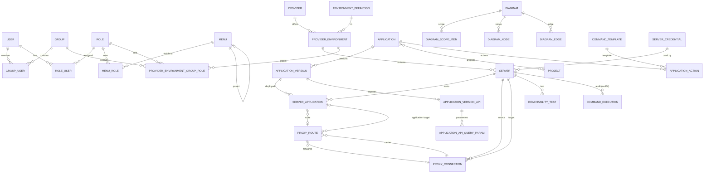

# Domain ERD

Model verified against the legacy on 2026-10-25: 26 entities, 4 join tables, `__EFMigrationsHistory` excluded.

## Aggregates

| Aggregate | Root | Content |
|---|---|---|
| Inventory | `Provider`, `EnvironmentDefinition` | `ProviderEnvironment`, `Server` |
| Catalog | `Application` | `ApplicationVersion`, `ApplicationVersionApi`, `ApplicationApiQueryParam` |
| Projects | `Project` | M-N association with `Application` |
| Topology | `ProxyConnection` | `ProxyRoute`, target application or connection |
| Diagrams | `Diagram` | `DiagramScopeItem`, `DiagramNode`, `DiagramEdge` |
| Administration | `User`, `Group`, `Role`, `Menu` | joins and `ProviderEnvironmentGroupRole` |
| Remote management | `ServerCredential`, `CommandTemplate`, `ApplicationAction`, `ReachabilityTest` | `CommandExecution` (audit) |

## Invariants

1. `ProviderEnvironment` is the provider × environment pair. The `ProviderEnvironment` scope of a diagram carries the `EnvironmentDefinition.Id`, **not** the `ProviderEnvironment.Id` (verified in `DiagramsService.BuildScopedTopologyAsync`).
2. `ProxyConnection.Direction`:
   - `Outgoing`: the source uses the target as a proxy.
   - `Incoming`: the source is a proxy for the target.
3. `ProxyRoute` points to a `ServerApplication` **or** to another `ProxyConnection`; both targets are optional.
4. `ServerApplication.ProxyRouteId` and `ProxyRoute.TargetServerApplicationId` form a nullable circular reference: import and deletes must clear external references before removing the rows.
5. `ServerCredential` is shared by multiple servers. The secret is encrypted, versioned and never serialized.
6. `CommandExecution` has no FK to `Server`: the history survives server deletion.
7. `DiagramNode`/`DiagramEdge`/`DiagramScopeItem` have a polymorphic `EntityId` with no FK. Validation happens in the service, not in the DB.
8. `Diagram.IsDefault` is an application invariant: at most one default diagram. MySQL has no partial unique indexes; the app enforces it in a transaction.
9. `SystemAdmin` does not imply `ServerAdmin`/`ServerOperator`: they are different scopes.
10. Legacy IDs are preserved during import, because diagrams reference them.

## Differences from the legacy

- `EnvironmentEntity` becomes `EnvironmentDefinition`; table `EnvironmentDefinitions`.
- Every domain table with its own PK gets `CreatedAt`, `UpdatedAt`, `Version` (except `CommandExecutions`).
- `ServerCredentials` gets `KeyVersion` and `NeedsReauth`.
- Numeric enums (`QueryParamTypeEnum`, `RequestTypeEnum`, `RoleScopeEnum`) become strings.
- `ApplicationActions.ParameterValues` moves from `longtext` JSON to a `JSON` column.
- Table/column names stay PascalCase, as in the legacy, to reduce importer mapping.
